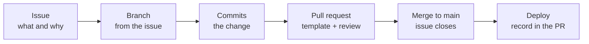

# Working on the DBA database in GitHub: issue → branch → pull request → deploy

Every change to this repository, `SurreyCountyCouncil/dba-database`, follows the same path. If this is your first change, set up your machine using [CONTRIBUTING.md](../../CONTRIBUTING.md) first.



Each stage keeps a different part of the record:

| Stage | Records |
|---|---|
| **Issue** | *Why*: the request, the problem, who asked for it |
| **Branch** | *Work in progress*, kept apart from `main` until it's ready |
| **Commits** | *What* changed, line by line |
| **Pull request** | *Review*: who checked it, what was tested, and where it was deployed |
| **`main`** | *Current state*: what every server should have |

An analogy is a change request in a hospital pharmacy. The prescription (issue) says what's needed and why. The preparation happens on a separate bench (branch), never on the shelf patients are served from. A second pharmacist checks it before it leaves (pull request review). Only then does it go on the shelf (`main`), and the dispensing log (deployment record) shows who received it.

**The rule that makes this work:** `main` only changes through a reviewed pull request. If anyone edits objects directly on a server or pushes straight to `main`, the record has gaps, and the next deployment silently overwrites the server change.

---

## 1. Raise an issue

Go to **Issues → New issue** and pick the template that matches the change:

| Issue template | When | PR template it leads to |
|---|---|---|
| New table, view or procedure | New object in an existing package | `new_object.md` |
| Change a view or procedure | Logic change, no table changes | `change_object.md` |
| Change a table (migration) | Columns, indexes, constraints or data in an existing table | `table_migration.md` |
| New package | A new capability that is deployed on its own (see [when to create a new package](01_adding-a-new-package.md#when-to-create-a-new-package)) | `new_package.md` |
| Update vendor code | A new release of Ola, the First Responder Kit, sp_WhoIsActive or Darling Data | `third_party_update.md` |
| Something is broken | Failing object, script or job, including emergency fixes made on a server | Whichever fits the fix |
| Documentation change | Wording in `README.md`, `CONTRIBUTING.md`, `docs/` or the issue and PR templates, with no SQL changes | The default template (no `?template=`) |

Fill in the *why* properly. A year from now, the issue is where someone will find out why a column exists.

**Assign** the issue to whoever will do the work. That also tells everyone else not to start on it. Before starting, check the open issues and pull requests in case someone is already changing the same objects.

## 2. Create a branch from the issue

**Easiest way:** on the issue page, in the right-hand sidebar under **Development**, click **Create a branch**. Choose "Checkout locally". GitHub suggests a name like `42-cpu-history-add-servername` and links the branch to the issue. Edit the name to add the type prefix below, e.g. `migration/42-cpu-history-add-servername`.

**Or from the command line**, using the naming convention `<type>/<issue-number>-<short-description>`:

```
git checkout main
git pull
git checkout -b migration/42-cpu-history-add-servername
```

| Type prefix | For |
|---|---|
| `object/` | New table, view or procedure |
| `change/` | View or procedure change |
| `migration/` | Table change |
| `package/` | New package |
| `vendor/` | Vendor code update |
| `fix/` | Something broken |
| `docs/` | Documentation only |
| `tooling/` | Scripts in `tools/` or GitHub workflows, with no SQL object changes |

**One issue per branch, and one branch per pull request.** Small, single-purpose pull requests are easier to review, and easier to revert if something goes wrong.

## 3. Make the change

Follow the guide for the change type:

- New package: [01_adding-a-new-package.md](01_adding-a-new-package.md)
- New object: [02_adding-objects-to-a-package.md](02_adding-objects-to-a-package.md), starting from `tools/templates/`
- Changing an object or a table: [03_changing-existing-objects-and-migrations.md](03_changing-existing-objects-and-migrations.md)

Commit as you go. Each commit message should say what changed and mention the issue:

```
git add 08_migrations 04_tables/cpu 10_metadata 09_deployment
git commit -m "CPU_Utilisation_History: add ServerName column (#42)"
git push -u origin migration/42-cpu-history-add-servername
```

Writing `#42` in a commit message links the commit to the issue.

**Keep your branch up to date.** If `main` has moved on while you were working, merge it into your branch:

```
git fetch origin
git merge origin/main
```

If the merge conflicts on **generated files** (`09_deployment/**`, `10_metadata/apply_extended_properties.sql`), don't fix them by hand. Resolve the conflicts in the CSV files, run `.\tools\generate_deploy.ps1`, and commit the regenerated output.

**Check your change against the coding standards.** From the repository root:

```powershell
.\tools\check_standards.ps1
```

It checks every object file and migration against the repository's rules, such as `CREATE OR ALTER`, table guards, named constraints and manifest coverage, and prints each problem as `file:line  rule  message`. The full rule list is at the top of the script. The same check runs automatically on every pull request, together with a check that the generated files are up to date, and a pull request that fails either one can't be merged.

Violations that existed before the check was introduced are listed in `tools/standards_exceptions.csv`. Don't add to that list to get a change through. If you fix one, delete its row: the check fails on an exception that no longer applies, so the list only shrinks.

**Test your branch in your own database.** Before you open the pull request, deploy your branch to a non-production instance, into a database that only you use. The deploy scripts take the database name as a variable, so each DBA can keep a copy on the shared dev server:

```
sqlcmd -S <dev-instance> -E -b -v RepoRoot="<repo path>" DatabaseName="DBA_<yourname>" DataPath="<data folder>" LogPath="<log folder>" -i 09_deployment\deploy_all.sql
```

After the first build, deploy just the package you changed. Run it twice: the second run proves the change can be re-deployed. Record what you ran and the result in the pull request's **Testing** section, not in the **Deployment record**.

Don't deploy a branch into a database that other people use, including the team's `DBA` database on the dev server:

- **Deployments overwrite each other.** Views and procedures deploy with `CREATE OR ALTER`, so whoever deploys last wins. If two people deploy different branches to the same database, one of them is testing code that is no longer there.
- **Migrations can't be taken back.** Once a migration has run on a shared database it must never be edited. If review then changes it, that database is left in a state no file in the repo describes. Your own database you can simply drop and rebuild.

## 4. Open the pull request

1. Push your branch. GitHub will show a **Compare & pull request** button.
2. Before filling anything in, add the template for your change type to the end of the address and reload the page. A web address can only have one `?`, so what you add depends on the address you have:

   | The address | Add | Result |
   |---|---|---|
   | Already contains `?expand=1`, as it does when you start from GitHub Desktop | `&template=table_migration.md` | The form opens straight away, with the template filled in |
   | Has no `?` in it | `?template=table_migration.md` | The compare page opens first. Click **Create pull request** and the form opens with the template. To skip that click, add `?expand=1&template=table_migration.md` instead |

   For example, from GitHub Desktop: `https://github.com/SurreyCountyCouncil/dba-database/compare/main...migration/42-cpu-history-add-servername?expand=1&template=table_migration.md`

   If you add `?template=…` to an address that already contains `?expand=1`, the template is ignored.
3. Title it the same way as the commit: `CPU_Utilisation_History: add ServerName column`.
4. In the description, write **`Closes #42`**. This links the PR to the issue and closes the issue automatically when the PR is merged.
5. Work through the template's checklist. Tick only what you've actually done. If an item doesn't apply, leave it unticked and write why on the same line, for example `**N/A:** no new dependencies`. A tick means "done", so an unticked item with a reason tells the reviewer more than a tick would. The coding standards and generated-file checks aren't in the checklists: they run once the PR is open, and their result appears in the PR's checks section.
6. Reviewers are requested automatically. `.github/CODEOWNERS` asks the DevOps Team to review every PR, and at least one approval from a code owner is needed before merging. You can't approve your own PR.

If the work isn't finished but you'd like early feedback, open it as a **Draft pull request**.

## 5. Review

The reviewer checks the change, not just the checklist:

- Do the **files changed** match what the issue asked for, and nothing more?
- **Migrations:** does every guard really detect "already applied"? Will it be safe on the largest server? Does the table file end up in the same state as the migration?
- **Views and procedures:** do the consumers listed still get what they expect?
- **Generated files:** does the diff in `09_deployment/` look like what the manifest change should produce?
- Was the **testing** actually done on a non-production instance?

Comment on specific lines, then either **Approve** or **Request changes**. The author pushes more commits to the same branch, and the PR updates automatically. Don't open a new PR.

## 6. Merge

When the PR is approved:

1. Use **Squash and merge**. All the branch's commits become one commit on `main`, titled after the PR. One change, one commit, so `git revert` can undo it cleanly.
2. Click **Delete branch**. The history is safe in `main` and in the PR.
3. The issue closes automatically because of `Closes #42`.

## 7. Deploy and record it

Your branch has already been tested in your own database (step 3). Shared databases, including the team's `DBA` database on the dev server, and every production server are deployed from an up-to-date `main`, so they only ever get reviewed code:

```
git checkout main
git pull
sqlcmd -S <instance> -E -b -v RepoRoot="<repo path>" DatabaseName="<database>" -i 09_deployment\packages\deploy_scc_cpu.sql
```

Then fill in the **Deployment record** table in the merged PR's description, one row per server: server, environment, who, date, commit, result. You can still edit a PR description after it's merged. Migrations are also logged on each server in `dbo.Migration_History`.

If a deployment fails or causes problems, reopen the issue, or raise a new **something is broken** issue, and link it to the PR.

---

## Emergency changes on a server

Sometimes something has to be fixed directly on a server before a pull request is possible. When that happens:

1. Make the fix, and save the exact SQL you ran.
2. **The same day**, raise a **Something is broken** issue. Answer *"Yes"* to "Was anything changed directly on the server?" and paste the SQL.
3. Bring the fix into the repo through the normal branch and pull request process.

Until step 3 is done, the server and the repo disagree. The next routine deployment will overwrite the emergency fix with the old code from `main`.

## Working alongside other DBAs

- **Keep pull requests small and short-lived.** A branch that stays open for weeks drifts from `main` and is painful to merge. One issue, one change, merged within days.
- **Expect conflicts in generated files, and don't hand-edit them.** When two PRs both add objects, both change `09_deployment/**` and `10_metadata/apply_extended_properties.sql`. Whoever merges second should run `git merge origin/main`, keep the CSV changes from both sides, run `.\tools\generate_deploy.ps1`, and commit the result.
- **`object_manifest.csv` conflicts are real conflicts.** Keep both rows. If two new objects ended up with the same `DeployOrder`, give one a different number.
- **Two migrations on the same day** both start `YYYYMMDD_`. Use the next free `_NN` number. Migrations run in file-name order.
- **Branches go only into your own database; everything shared gets `main`.** Test your branch in a database only you use, such as `DBA_<yourname>`. Never deploy a branch into a shared database or to a production server. Those must only ever have code that has been reviewed.
- **Ask in the issue or PR, not in chat.** Questions and answers there become part of the record.

## Repository setup (one-off, for an admin)

Done once when the repository is created. The workflow above relies on these settings:

| Setting | Where | Why |
|---|---|---|
| Ruleset on `main`: require a pull request, 1 approval, **review from Code Owners**, and dismiss stale approvals when new commits are pushed. Block force pushes and deletion | Settings → Rules → Rulesets | Nothing reaches `main` without a DevOps Team review |
| Give the DevOps Team **Write** access | Settings → Collaborators and teams | Lets the team push branches and review. `CODEOWNERS` only works for teams with write access |
| Allow only **squash merging** | Settings → General → Pull Requests | One commit per change |
| Automatically delete head branches | Settings → General → Pull Requests | Keeps the branch list clean |
| In the ruleset on `main`, **require status checks to pass** and add `check` (the job in `.github/workflows/standards.yml`). It appears in the list after the workflow has run once | Settings → Rules → Rulesets | A pull request that breaks the coding standards, or has out-of-date generated files, can't be merged |
| Create the labels `new-object`, `change-object`, `migration`, `new-package`, `third-party`, `bug`, `docs` | Issues → Labels | The issue templates apply these labels. A label that doesn't exist in the repo isn't applied |

## Quick reference

```
Issue (template)  ->  "Create a branch" on the issue  ->  change + commit "(#n)"
  ->  test the branch in your own database (record under Testing)
  ->  push  ->  PR with ?template=...  +  "Closes #n"  ->  review  ->  squash and merge
  ->  deploy from main  ->  fill in the Deployment record
```
